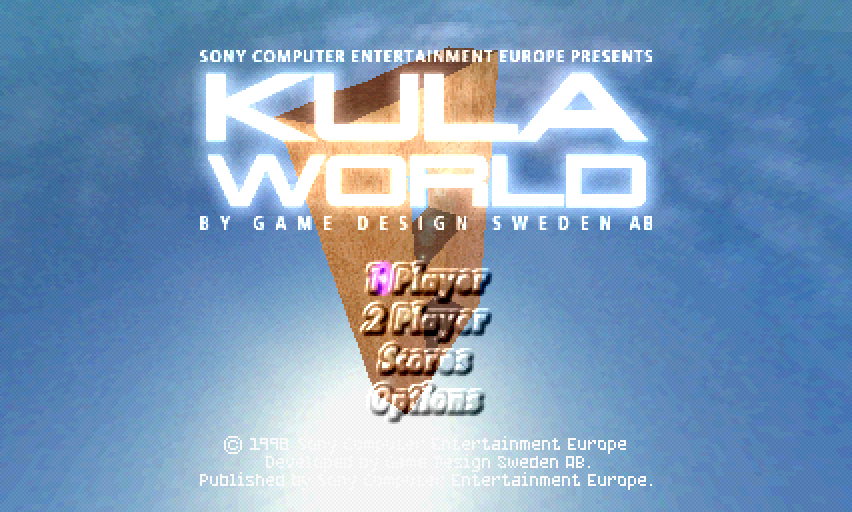
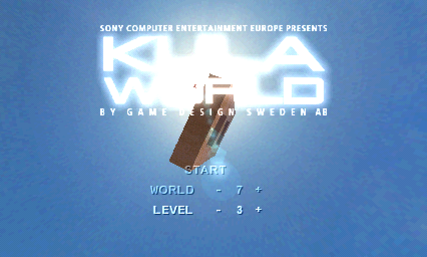
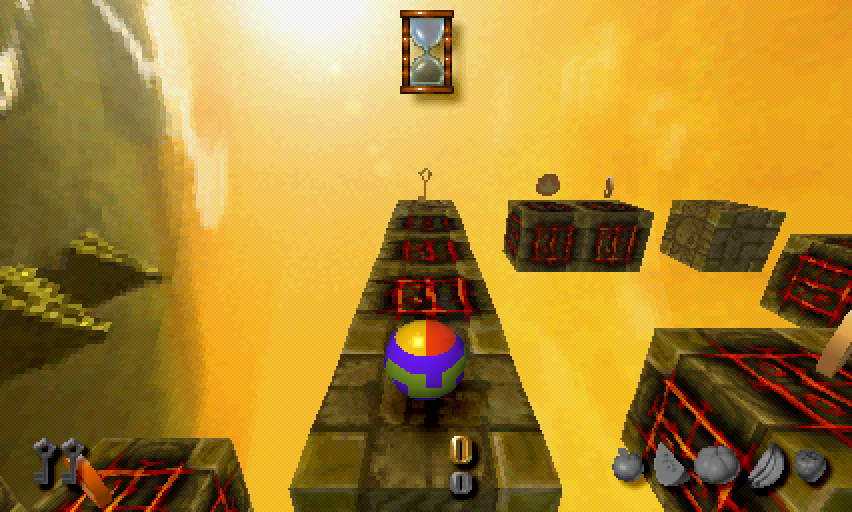
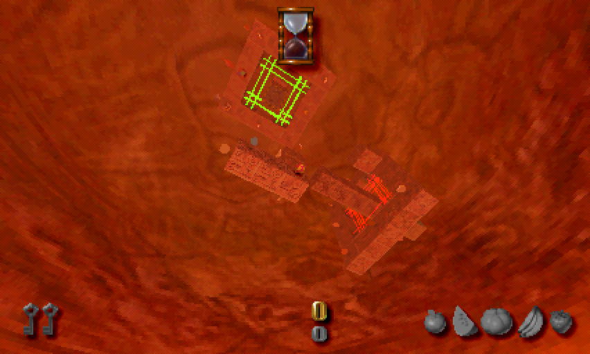

# Kula World Rerolled

Kula World as a native game for Linux, macOS and Windows, with the things the
PlayStation could not do:

- **Real widescreen up to 21:9.** The world is rendered wider, not stretched:
  objects at the edges stay visible, the sky reaches the corners, the HUD moves
  to the wide corners, and loading, score and memory-card screens fill the sides.
- **No PS1 wobble.** Polygons and textures stay still (PGXP), and far cubes and
  items keep their full detail instead of turning blurry or into plain discs.
- **HD textures from your own disc.** While you play, the game builds an HD
  texture pack from your disc in the background, optionally with an AI upscaler.
  Nothing is downloaded that contains game data.
- **Level select.** Start any of the 150 levels directly.
- **Faithful at its core.** The game's own code runs natively, recompiled ahead
  of time, not emulated. The attract demo plays out exactly as on the reference
  emulator, at the original 50 fps.
- **Just your disc.** No BIOS dump needed; the MIT-licensed OpenBIOS is bundled.

It is a static recompilation of **Kula World** (PAL, SCES-01000), built on
[psxrecomp](https://github.com/RetroPortingToolKit/psxrecomp) and
[recomp-ui](https://github.com/RetroPortingToolKit/recomp-ui): the MIPS code is
translated to C and compiled into a native executable.

| | |
|---|---|
|  |  |
|  |  |

## AI-Assisted Development
> [!IMPORTANT]
> This project was created with significant AI assistance, and that is intentional and transparent.
>
> Parts of the codebase were generated with AI, but the application was not shipped as unchecked output. The generated code was reviewed, corrected, and validated by a human developer before being kept in the project.

## Status

Playable; all ten worlds start and run (checked via Level Select), the ending FMV plays. The recompiled game reaches the same
attract demo, with the same timer values, as the psx-beetle reference
emulator.

| Platform | State |
|---|---|
| Linux (x86-64) | runs; the release zip (glibc 2.35+) is tested on a fresh Ubuntu 22.04, development happens on Alpine/musl |
| macOS (Apple Silicon, M1 Pro) | runs at 50 fps; audio, memory card, launcher, keyboard, gamepad and the release `.app` verified |
| Windows (x64) | cross-built with MinGW-w64; the release zip boots to the demo under Wine; not yet tested on a real Windows PC |

## Mods

All mods are switchable on the launcher's Mods page (recomp-ui).

| Mod | Default | What it does |
|---|---|---|
| Level Select | on | "Arcade" opens START / WORLD / LEVEL. Starting anywhere but world 1, level 1 counts as cheated: no save points, no high-score entry. |
| Widescreen | on | Shows the world wider than 4:3 and follows the window up to 2.4:1 (21:9 ultrawide). The key and fruit HUD (with their pickup sparkles) move to the wide corners. The loading screen, high-score table and memory-card screens fill the side bands too, and the pill's motion trail covers the full width. The warning screen and FMVs stay 4:3. |
| CD Speed | on, 2x | Shorter loading. |
| Detail Distance | on | Far cubes keep their full texture and far coins and fruit keep their full model instead of a plain disc. The short blur while turning stays. |
| HD Textures | off | Builds an HD texture pack from your own disc in the background while you play; it is used from the next start. Python is downloaded once (Linux glibc, macOS Apple Silicon; Windows not tested yet). The optional AI model (CC BY-NC-SA 4.0, about 1.5 GB) needs its own switch; without it the pack is upscaled with Lanczos. No game data ships with the release. |

The wobble fix (PGXP, on by default) is a launcher setting on its own page. It
needs an internal resolution of at least 2x; the launcher defaults to 4x.

## Playing a release

You need your own copy of the game: Kula World PAL, SCES-01000, as a BIN/CUE image
(single data track, MD5 `0f675dc230354f8c3b835bf34841bd20`).

Unpack the archive for your system (Linux: `.tar.gz`, macOS and Windows: `.zip`) and start `Kula_World_Rerolled` (macOS: `Kula World Rerolled.app`),
then point the launcher at your disc image. No BIOS dump is needed.

**macOS:** the app is not notarized, so macOS blocks the first start. Open
**System Settings > Privacy & Security** and click **Open Anyway**, or run once in Terminal:

```sh
xattr -dr com.apple.quarantine "Kula World Rerolled.app"
```

Saves, settings and the HD texture pack live in `~/Library/Application Support/Kula World Rerolled`,
so replacing the app with a newer version keeps them.

## Build it yourself

### Requirements

- Your disc as `disc/SCES01000.BIN` + `disc/SCES01000.CUE` (see above).
- Optional: a SCPH-1001 BIOS dump as `bios/SCPH1001.BIN`. Without it the bundled OpenBIOS is used.
- [go-task](https://taskfile.dev), CMake, Ninja, a C/C++ compiler, SDL3, Python 3.11+.
  - Alpine: `apk add cmake samurai pkgconf sdl3-dev mesa-dev linux-headers libucontext-dev`
  - macOS: see [docs/BUILD_MACOS.md](docs/BUILD_MACOS.md)
  - Windows: cross build from Linux, see [docs/BUILD_WINDOWS.md](docs/BUILD_WINDOWS.md)

### Steps

```sh
git clone --recursive https://github.com/zap0xfce2/Kula-World-Rerolled.git
cd Kula-World-Rerolled
# put your disc (and optionally the BIOS) in place, then:
task all        # emitters, generate, dev build with debug server
task build      # release build
task run        # start with the launcher
```

Both submodules track upstream `master`. In a clone from before 2026-11-24 run
`git submodule sync --recursive` once, the submodules used to point at forks.

The launcher ships with its own box art. `task boxart` fetches the original
PAL cover from [libretro-thumbnails](https://github.com/libretro-thumbnails/libretro-thumbnails)
into `assets/launcher/original/` for your local build only (it is not part of
this repository). Reconfigure and relink afterwards.

Release archives (no game data inside) come from `task release:linux` (Docker), `task release:win`
and, on a Mac, `task release:mac`; they land in `dist/`.

`task --list` shows everything else (tests, lint, smoke test, the psx-beetle
oracle, a level-timer freeze for long test sessions). On macOS pass
`PYTHON=python3.12`. The first generate takes a few minutes; the recompiled C
in `generated/` is not committed.

## Known issues

None known right now. Please open an issue if you find one.

## Legal

You must own the original game. This repository contains no game data: no
disc image, no BIOS, no extracted assets, no disassembly with original bytes,
and no recompiled game C. Addresses and symbol names used by the mods are
facts about the executable.

Kula World is © 1998 Sony Computer Entertainment Europe, developed by Game
Design Sweden AB. This project is not affiliated with or endorsed by Sony.

## Credits

- [psxrecomp](https://github.com/RetroPortingToolKit/psxrecomp) and [recomp-ui](https://github.com/RetroPortingToolKit/recomp-ui): the recompiler, runtime and launcher
- [OpenBIOS](https://github.com/grumpycoders/pcsx-redux) (MIT), bundled with psxrecomp
- [dezgeg/kula-world-decomp](https://github.com/dezgeg/kula-world-decomp): function boundaries, names and addresses used as reference
- The Kula World community documentation at [wiki.kula.quest](https://wiki.kula.quest/)
