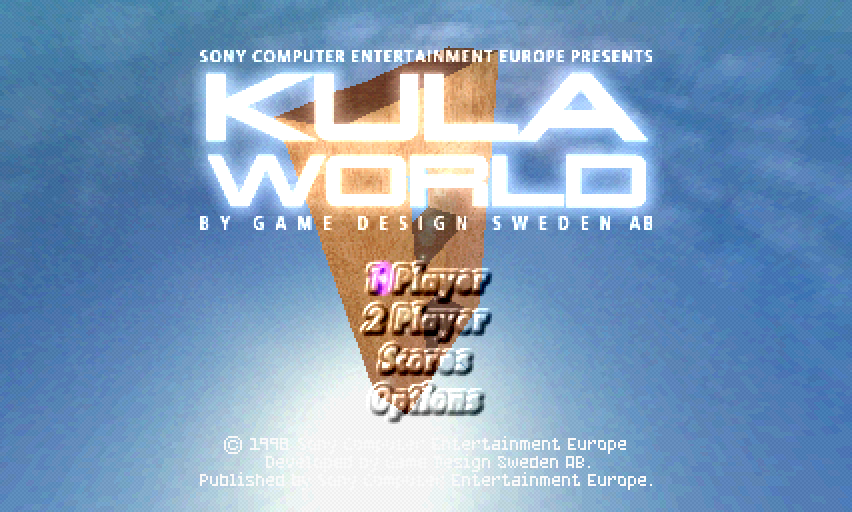
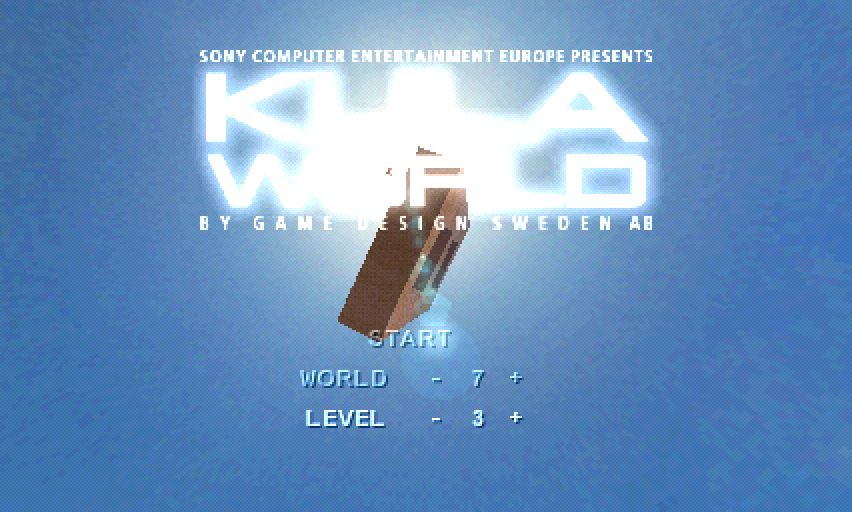
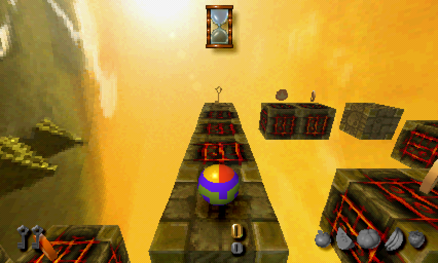
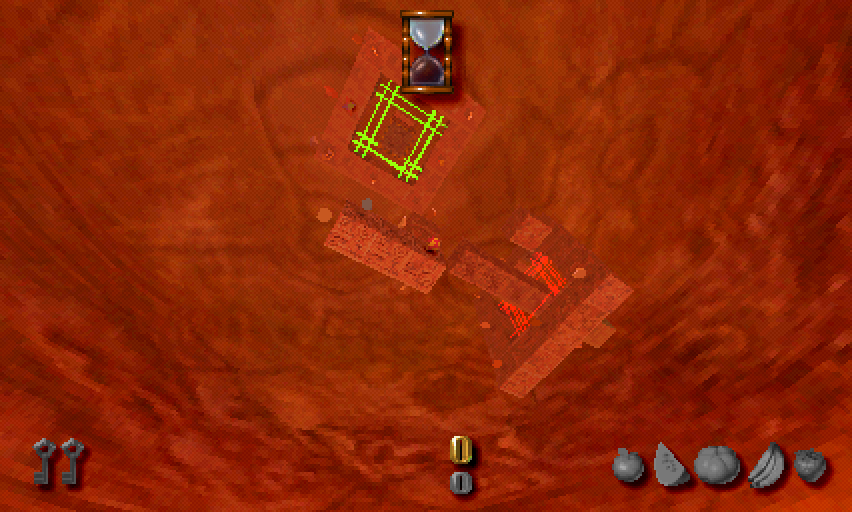

# Kula World Recompiled

A static recompilation of **Kula World** (PAL, SCES-01000) to native Linux, macOS and Windows (comming soon!), built on [psxrecomp](https://github.com/RetroPortingToolKit/psxrecomp)
and [recomp-ui](https://github.com/RetroPortingToolKit/recomp-ui).

The game's MIPS code is translated to C ahead of time and compiled into a
native executable. No emulator core runs the game. Bring your own disc image;
a retail BIOS is optional because the bundled, MIT-licensed OpenBIOS works.

| | |
|---|---|
|  |  |
|  |  |

## AI-Assisted Development
> [!IMPORTANT]
> This project was created with significant AI assistance, and that is intentional and transparent.
>
> Parts of the codebase were generated with AI, but the application was not shipped as unchecked output. The generated code was reviewed, corrected, and validated by a human developer before being kept in the project.

## Status

Playable; all ten worlds start and run (checked via Level Select), the ending FMV plays. The recompiled game reaches the same
attract demo, with the same timer values, as the psx-beetle reference
emulator.

| Platform | State |
|---|---|
| Linux (x86-64, tested on Alpine/musl) | builds and runs; tested headless under Xvfb |
| macOS (Apple Silicon, M1 Pro) | builds and runs at 50 fps; audio, memory card, launcher, keyboard verified |
| Windows | not tested |

## Mods

All mods are switchable in the launcher (recomp-ui).

| Mod | Default | What it does |
|---|---|---|
| Level Select | on | "Arcade" opens START / WORLD / LEVEL. Starting anywhere but world 1, level 1 counts as cheated: no save points, no high-score entry. |
| Widescreen | on | Shows the world wider than 4:3 and follows the window up to 2:1. The key and fruit HUD (with their pickup sparkles) move to the wide corners. The loading screen, high-score table and memory-card screens fill the side bands too, and the pill's motion trail covers the full width. The warning screen and FMVs stay 4:3. |
| CD Speed | on, 2x | Shorter loading. 4x is faster but hangs world changes that start past level 1, so the project default is 2x. |

## Requirements

- Your own copy of the game: Kula World PAL, SCES-01000, as `disc/SCES01000.BIN` + `disc/SCES01000.CUE`
  (single data track, MD5 `0f675dc230354f8c3b835bf34841bd20`).
- Optional: a SCPH-1001 BIOS dump as `bios/SCPH1001.BIN`. Without it the bundled OpenBIOS is used.
- [go-task](https://taskfile.dev), CMake, Ninja, a C/C++ compiler, SDL3, Python 3.11+.
  - Alpine: `apk add cmake samurai pkgconf sdl3-dev mesa-dev linux-headers libucontext-dev`
  - macOS: see [docs/BUILD_MACOS.md](docs/BUILD_MACOS.md)

## Build

```sh
git clone --recursive https://github.com/zap0xfce2/kula-world-recompiled.git
cd kula-world-recompiled
# put your disc (and optionally the BIOS) in place, then:
task all        # emitters, generate, dev build with debug server
task build      # release build
task run        # start with the launcher
```

Until [psxrecomp#676](https://github.com/RetroPortingToolKit/psxrecomp/pull/676)
and [#692](https://github.com/RetroPortingToolKit/psxrecomp/pull/692) are merged,
the `psxrecomp` submodule points at a fork that carries them.

`task --list` shows everything else (tests, lint, smoke test, the psx-beetle
oracle, a level-timer freeze for long test sessions). On macOS pass
`PYTHON=python3.12`. The first generate takes a few minutes; the recompiled C
in `generated/` is not committed.

## Roadmap

Done:
- [x] Disc and EXE analysis; the EXE runs from KUSEG, which upstream had never tested
- [x] Recompilation boots BIOS → title → menu → 3D level, with 0 dispatch misses
- [x] A/B against psx-beetle: identical attract demo and timer values
- [x] macOS build verified (50 fps, audio, memory card, launcher)
- [x] OpenBIOS: plays without a retail BIOS, including memory card saves
- [x] Level Select mod
- [x] Widescreen mod up to 2:1, HUD in the corners, edge culling widened on both sides
- [x] CD Speed default (2x)
- [x] Upstream reports: KUSEG result and portability findings for musl/macOS
- [x] Upstream PR: widescreen band form for register compares ([psxrecomp#676](https://github.com/RetroPortingToolKit/psxrecomp/pull/676))
- [x] Widescreen: filled side bands on still screens, HUD sparkles in the corners, pill trail at full width
- [x] Upstream PR: framebuffer-feedback sprites in the bands ([psxrecomp#692](https://github.com/RetroPortingToolKit/psxrecomp/pull/692))
- [x] Upstream PRs for the musl/macOS findings ([#693](https://github.com/RetroPortingToolKit/psxrecomp/pull/693), [#694](https://github.com/RetroPortingToolKit/psxrecomp/pull/694))
- [x] Ending FMV plays

Next:
- [ ] Widescreen: sky refresh after resizing the window inside a level
- [ ] Widescreen wider than 2:1 (needs a wider generated sky)
- [ ] 60 fps (parked: psxrecomp's frame generation does not see Kula's flips yet; an NTSC-style patch would change the gameplay timing)
- [ ] Own loading screen instead of the piracy warning shown during the first load
- [ ] HD textures, wobble fix
- [ ] Controller test on macOS
- [ ] Windows build
- [ ] Release packaging

## Known issues

- Widening the window inside a level leaves a gap in the sky until the camera turns.
- Particles can disappear early at the left edge of the widescreen band.
- CD Speed 4x hangs world changes that start past level 1 (cause unknown, 2x is safe).

## Legal

You must own the original game. This repository contains no game data: no
disc image, no BIOS, no extracted assets, no disassembly with original bytes,
and no recompiled game C. Addresses and symbol names used by the mods are
facts about the executable.

Kula World is © 1998 Sony Computer Entertainment Europe, developed by Game
Design Sweden AB. This project is not affiliated with or endorsed by Sony.

## Credits

- [psxrecomp](https://github.com/RetroPortingToolKit/psxrecomp) and [recomp-ui](https://github.com/RetroPortingToolKit/recomp-ui): the recompiler, runtime and launcher
- [OpenBIOS](https://github.com/grumpycoders/pcsx-redux) (MIT), bundled with psxrecomp
- [dezgeg/kula-world-decomp](https://github.com/dezgeg/kula-world-decomp): function boundaries, names and addresses used as reference
- The Kula World community documentation at [wiki.kula.quest](https://wiki.kula.quest/)
